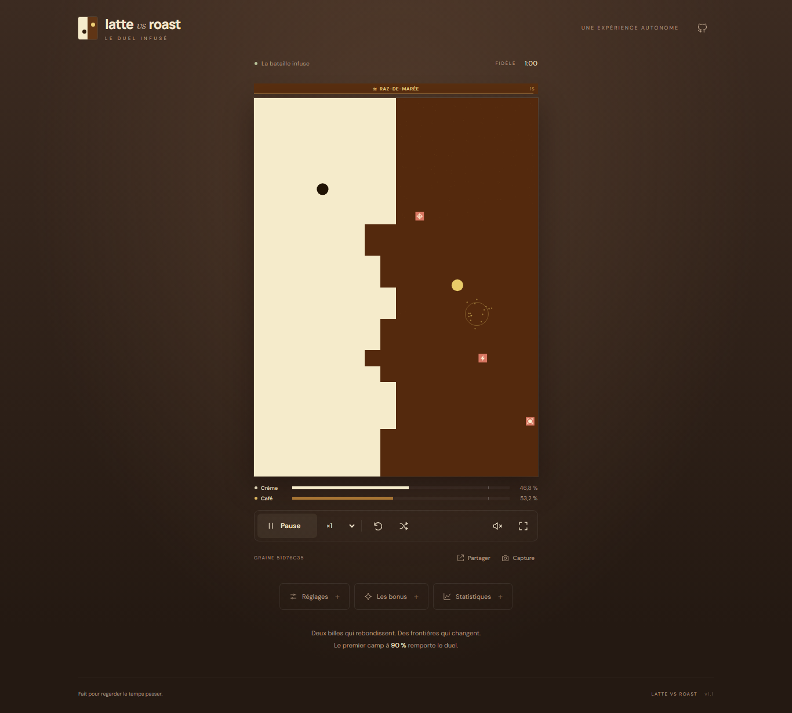

# Latte vs Roast

Une bataille de territoires au parfum de café. Deux billes autonomes font avancer leurs couleurs, ramassent des bonus et se disputent un plateau qui change à chaque rebond.

**[Ouvrir le jeu](https://matteo12sa.github.io/latte-vs-roast/)** · [Règles de reconstruction](docs/RECONSTRUCTION.md) · [Historique des versions](CHANGELOG.md)

L’interface démarre en **anglais**. Le sélecteur **English / Français**, en haut à droite, traduit immédiatement le jeu et mémorise le choix. Les camps sont **Latte / Roast** en anglais et **Crème / Café** en français. La partie démarre automatiquement avec le son activé ; selon la politique du navigateur, les effets sonores commencent au premier clic, toucher ou appui sur une touche.



## Jouer

- **Pause / reprendre** : bouton de commande ou touche Espace, hors des champs de saisie.
- **Nouvelle partie** : nouvelle graine aléatoire. **Rejouer** : mêmes règles et même graine.
- **Vitesse** : ×0,5, ×1, ×2 ou ×4 ; les règles de la simulation ne changent pas.
- **Plein écran**, effets sonores activés par défaut avec bouton de coupure, volume et réduction des effets visuels.
- **Partager** : copie un lien contenant les règles et la graine de la partie, pour la relancer depuis le début.
- **Capture** : télécharge une image PNG du terrain et de son état.

À chaque contact avec une case adverse, une bille la convertit puis rebondit. La première équipe à atteindre le seuil de domination gagne. En mode **Fidèle**, le terrain mesure 18 × 24 cases et le seuil vaut 90 %, soit 389 cases sur 432. Il n’y a pas de durée limite.

Le rythme par défaut est réglé à 11 cases/s avec un bonus toutes les 2 secondes : **8 min 21 s de simulation en moyenne sur 600 parties**, soit **2 min 05 s à ×4**. Les parties peuvent durer davantage ; les détails et les résultats reproductibles figurent dans la [mesure des durées](docs/DUREES.md).

Les onze bonus vont d’une accélération temporaire à une tourelle, en passant par une bille géante, des renforts et une traversée des frontières. Le guide intégré explique chacun d’eux dans la langue choisie ; les captures PNG utilisent aussi cette langue.

## Personnaliser

Le profil **Fidèle** conserve la configuration de référence. Le profil **Personnalisé** permet de choisir :

| Réglage | Plage |
| --- | --- |
| Colonnes | 12 à 30, par nombre pair |
| Lignes | 16 à 40 |
| Vitesse initiale | 4 à 12 cases/s |
| Seuil de victoire | 70 à 100 % |
| Intervalle entre bonus | 1 à 10 s |
| Bonus disponibles | Activation individuelle des onze types |

Les changements de règles s’appliquent à la prochaine partie. Le thème, le son, la réduction des effets et la vitesse de lecture peuvent changer pendant une partie. Trois thèmes sont disponibles : café, nuit et contraste renforcé.

Les préférences et les 100 dernières parties terminées sont conservées **dans ce navigateur**. Elles ne sont pas synchronisées entre appareils. Le jeu reste utilisable lorsque le stockage local n’est pas disponible. Une commande permet de réinitialiser les préférences sans effacer l’historique.

Le panneau Statistiques affiche immédiatement la durée, les parts de territoire, le nombre de billes et la courbe du **duel en cours**. Les compteurs de victoires et la durée moyenne concernent les parties terminées. Les résultats restent visibles après rechargement ; ceux d’une ancienne version des règles sont conservés mais leur rejeu est désactivé.

Le passage d’anglais à français conserve la partie, la pause et les réglages en cours de saisie. Les anciennes préférences de la version 1.1, qui n’avaient pas de langue, adoptent les nouveaux défauts anglais/son activé. Les choix de langue et de son effectués ensuite sont conservés, y compris une coupure volontaire du son.

## Installation locale

Prérequis : **Node.js 24 ou plus récent**, npm et Git.

```sh
git clone https://github.com/MATTEO12SA/latte-vs-roast.git
cd latte-vs-roast
npm ci
npm run dev
```

Ouvrir l’adresse affichée par Vite, avec le chemin `/latte-vs-roast/`.

| Commande | Fonction |
| --- | --- |
| `npm run dev` | Serveur de développement local |
| `npm run build` | Vérification TypeScript et production de `dist/` |
| `npm run preview` | Prévisualisation locale du site compilé |
| `npm run typecheck` | Vérification des types |
| `npm run lint` | Analyse statique ESLint |
| `npm test` | Tests Vitest, dont 200 graines de simulation |
| `npm run test:stress` | Tests de robustesse seuls |
| `npm run test:e2e` | Tests de navigation Playwright |
| `npm run simulate` | Mesure reproductible de la durée de 300 parties complètes |

Avant la première exécution de Playwright :

```sh
npx playwright install chromium firefox webkit
```

Sous Linux, utiliser `npx playwright install --with-deps chromium firefox webkit` si les bibliothèques système ne sont pas encore présentes.

La mesure de durée utilise le même moteur que le jeu, sans affichage ni son. Exemple : `npm run simulate -- --count 300 --first-seed 1 --limit 7200 --output .local/durations.json`. Les résultats distinguent moyenne, médiane, percentiles et parties inachevées au plafond de mesure ; ces dernières ne sont jamais comptées comme des victoires ni incluses dans la moyenne. Les secondes mesurées sont celles de la simulation : à ×4, le temps d’observation sans pause est divisé par quatre.

## Architecture

TypeScript et Vite, rendu Canvas 2D, commandes HTML/CSS. Aucun serveur applicatif, compte joueur, moteur 3D ou service de statistiques externe n’est nécessaire.

- La simulation utilise un pas fixe de **1/120 s** et un générateur aléatoire à graine.
- Le rendu, les particules et le son ne modifient pas les règles ou les tirages aléatoires.
- Les effets temporaires sont calculés à partir des propriétés de base et de leurs activations encore présentes.
- Le temps de simulation s’arrête lorsque l’onglet est masqué, sans rattrapage au retour.
- La version des règles est distincte de celle de l’application. Un lien contenant des règles incompatibles affiche un message au lieu de changer silencieusement de partie.

La reproductibilité s’entend pour une même version des règles et une même configuration. Les pauses et la vitesse de lecture ne doivent pas modifier l’issue de la simulation.

## Vérification

La livraison 1.2 a été vérifiée par **64 tests Vitest et 51 tests navigateur**. Les conditions, mesures de performance et limites figurent dans le [compte rendu de validation](docs/VALIDATION.md).

La suite Vitest couvre les collisions, les conversions, les seuils de victoire, les onze bonus, les cumuls, les expirations et la reproductibilité. Le test de robustesse exerce **200 graines**, pendant 120 secondes simulées ou jusqu’à la victoire, et vérifie les comptes de cases, les bornes, les vitesses et les plafonds d’entités.

Playwright vérifie l’interface dans Chromium, Firefox et WebKit, avec des tailles d’écran d’ordinateur et de téléphone. Une simulation d’écran mobile et WebKit sur ordinateur ne remplacent pas un essai sur téléphone réel. **La compatibilité sur matériel mobile réel reste à vérifier.**

## Publication

Les poussées sur `main` lancent le workflow **Vérifier et publier**. GitHub Actions installe les dépendances verrouillées, exécute les vérifications et tests, compile le site, puis publie `dist/` sur GitHub Pages uniquement si toutes les étapes réussissent. Les pull requests exécutent les vérifications sans publier.

Configuration Pages : **GitHub Actions**. Le chemin de base Vite vaut `/latte-vs-roast/` ; il doit être adapté si le dépôt est renommé. L’adresse du projet est `https://matteo12sa.github.io/latte-vs-roast/`.

Pour revenir à une version validée, rétablir le commit correspondant sur `main` et laisser le workflow la republier. Aucune donnée serveur n’est à migrer.

## À propos de la référence

Ce projet est une reconstruction indépendante à partir d’une vidéo de gameplay. Les proportions, couleurs et mécaniques visibles servent de référence. Certaines règles peu visibles ont été choisies explicitement et sont décrites dans [RECONSTRUCTION.md](docs/RECONSTRUCTION.md). La même trajectoire et la même victoire à 1 min 28 ne sont pas promises.

La vidéo n’est pas incluse dans le dépôt. Le code et les éléments graphiques générés par le projet sont publiés sous [licence MIT](LICENSE). Les polices DM Sans et Manrope sont incluses localement sous licence SIL Open Font License ; leurs notices sont dans `public/fonts/`.
